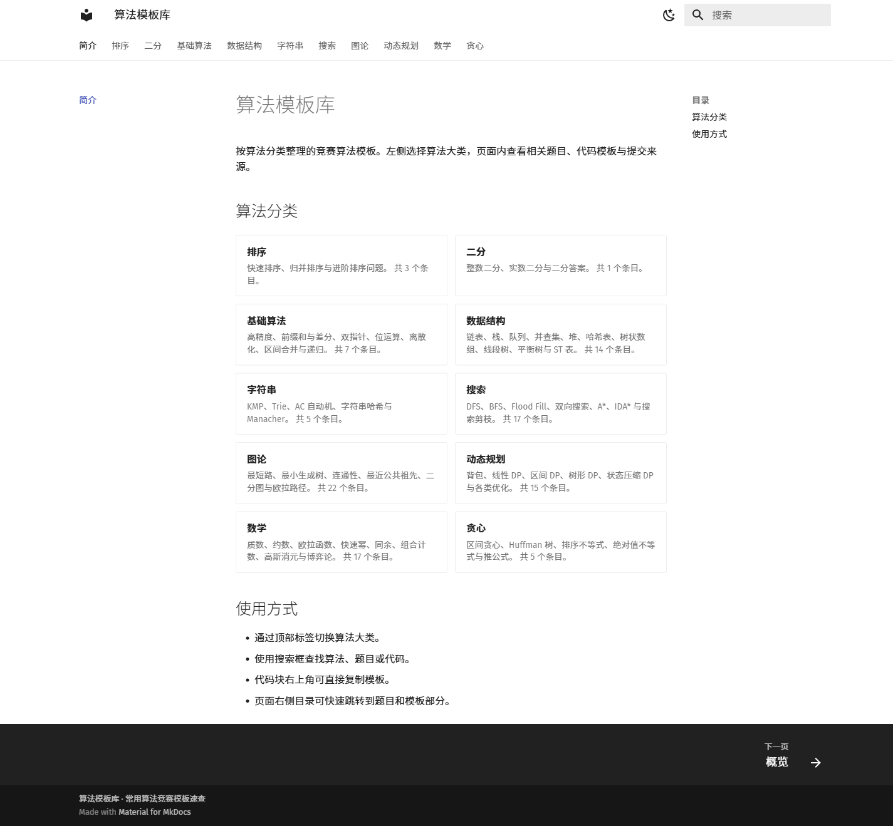
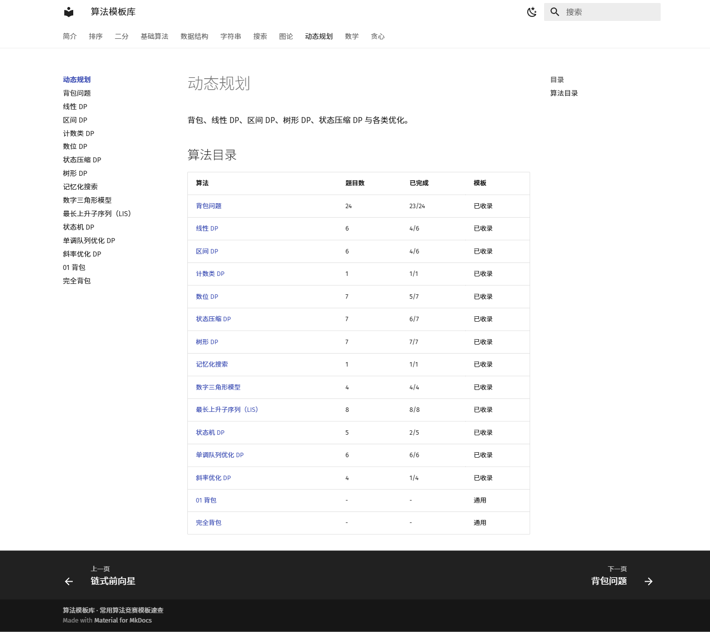

# 算法模板库

一个基于 **MkDocs Material** 的算法竞赛模板速查站。页面布局、字体、配色和三栏文档结构与 [OI Wiki 动态规划页面](https://oi-wiki.org/dp/) 保持同一套视觉体系。

## 在线网站

- 网站：<https://xirnej.github.io/algorithm-templates/>
- 仓库：<https://github.com/xirneJ/algorithm-templates>


当前包含 10 个算法分类、106 个算法页面。内容由 32 个通用模板，以及 AcWing 算法基础课、算法提高课中的题目按算法重新归并而成。

## 算法分类

- 排序
- 二分
- 基础算法
- 数据结构
- 字符串
- 搜索
- 图论
- 动态规划
- 数学
- 贪心

原始 117 个课程分组经过去重后归入 104 个算法条目，325 道题目全部保留；其中 64 个分组已从当前账号的提交记录中提取模板。

算法页不再保留独立的通用模板区：有你的提交代码时，提交代码直接作为“模板”；没有提交代码时不显示模板区。



## 预览

在 PowerShell 中运行：

```powershell
.\serve.ps1
```

然后访问 <http://127.0.0.1:8000>。

也可以直接使用 MkDocs：

```powershell
python -m mkdocs serve
```

## 构建

```powershell
.\build.ps1
```

构建产物位于 `site/`。构建脚本会执行：

1. `mkdocs build --strict`
2. `node tests/site.test.mjs`
3. `node tests/taxonomy.test.mjs`

## 自动部署

推送到 `main` 分支后，GitHub Actions 会自动执行：

1. 安装 `requirements.txt` 中的依赖
2. 执行 `mkdocs build --strict`
3. 运行站点与分类测试
4. 发布 `site/` 到 GitHub Pages

工作流文件：`.github/workflows/deploy-pages.yml`

公开仓库不包含 `PROGRESS.md` 和 `planning/acwing-submissions.json`，这些本地交接与原始提交数据仅保留在本机。
## 技术栈

- MkDocs 1.6.1
- Material for MkDocs 9.6.15
- Python 3.12
- Markdown
- Fira Sans / Fira Mono
- Material 内置搜索与代码复制
- 自定义 CSS 变量覆盖

OI Wiki 本身由 MkDocs Material 生成，因此这里直接使用同一主题版本，而不是重新实现文档布局。

## 目录结构

```text
├── docs/
│   ├── index.md                 # 首页
│   ├── sorting/                 # 排序
│   ├── binary-search/           # 二分
│   ├── basics/                  # 基础算法
│   ├── ds/                      # 数据结构
│   ├── string/                  # 字符串
│   ├── search/                  # 搜索
│   ├── graph/                   # 图论
│   ├── dp/                      # 动态规划
│   ├── math/                    # 数学
│   ├── greedy/                  # 贪心
│   └── stylesheets/extra.css    # OI Wiki 风格覆盖
├── tests/site.test.mjs          # 分类、页面与构建产物验收
├── tests/taxonomy.test.mjs      # 117 个原始分组的归类与提交来源验收
├── scripts/generate-algorithm-library.cjs # 算法分类页面生成脚本
├── planning/                    # 设计、课程结构和提交数据
├── legacy/                      # 重构前的旧页面，不被新站引用
├── mkdocs.yml                   # 站点、导航、主题与 Markdown 配置
├── requirements.txt
├── serve.ps1
└── build.ps1
```

## 添加模板

1. 在对应分类目录下新建 Markdown 文件，例如 `docs/dp/new-dp.md`。
2. 使用统一页面结构：

````markdown
---
title: 新模板
description: 一句话说明。
tags:
  - 标签
---

# 新模板

一句话说明。

## 思路

说明状态设计、转移或实现思路。

## 模板

```cpp
#include <bits/stdc++.h>
using namespace std;

// ...
```

## 复杂度

| 时间 | 空间 |
| --- | --- |
| `O(n)` | `O(n)` |

## 易错点

- 边界条件。
- 初始化方式。
````

3. 在 `mkdocs.yml` 的 `nav` 中加入页面。
4. 运行 `.\build.ps1` 验证。

## 本地依赖

仓库中已经准备了项目内依赖目录 `.python-packages/`，`serve.ps1` 和 `build.ps1` 会自动使用它。

如果在新环境中重新安装：

```powershell
python -m venv .venv
.\.venv\Scripts\Activate.ps1
python -m pip install -r requirements.txt
```

也可以直接安装到当前 Python：

```powershell
python -m pip install -r requirements.txt
```

## 设计约定

- 默认浅色主题，支持深色主题切换。
- 顶部为站点标题、当前页面标题、搜索框和主题切换。
- 一级标签为 6 个算法分类。
- 左侧为分类导航，中间为正文，右侧为页内目录。
- 正文沿用 Material 默认 61rem 网格、12.1rem 左右侧栏和 16px / 1.6 正文字号。
- 代码块使用 Fira Mono，并启用右上角复制按钮。
- 搜索索引由 Material 在构建时生成，不依赖后端服务。

## 测试

```powershell
node tests/site.test.mjs
```

测试会验证：

- 32 个算法页面完整存在。
- 每页包含标题、模板、C++ 代码块和复杂度表。
- Material 主题、字体、主色、强调色与搜索配置正确。
- 构建产物包含 OI Wiki 风格的页面骨架。

## 旧版本

重构前的单页版本保存在 `legacy/`，仅用于对照和迁移，不会被新站加载。
